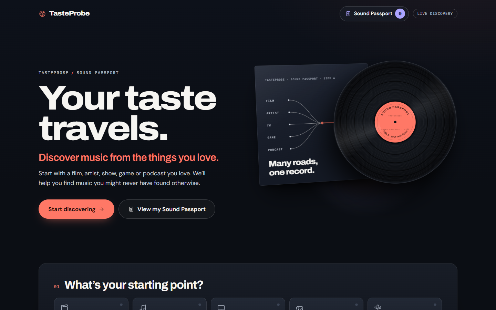
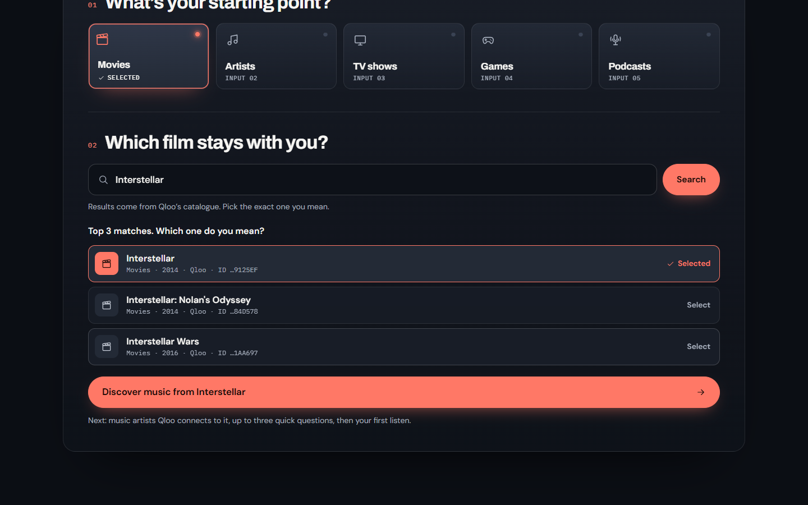
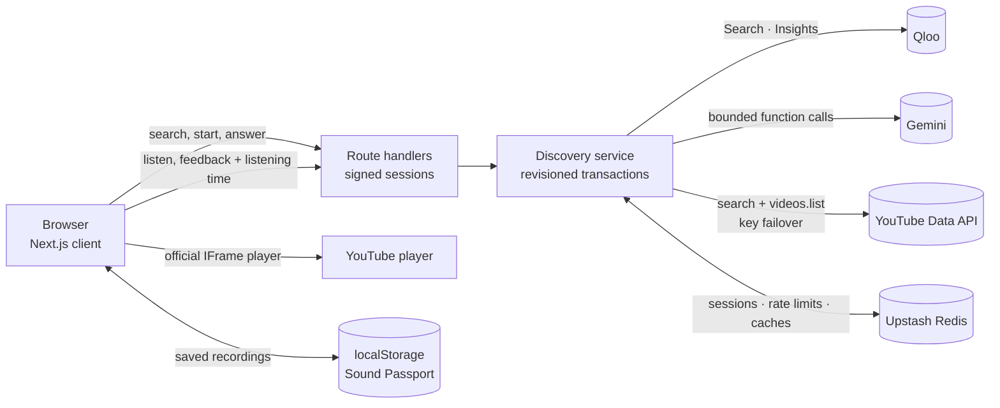

# TasteProbe — Sound Passport

**Discover music from the films, artists, shows, games and podcasts you already love.**

**Live app:** https://taste-probe.vercel.app · **License:** [MIT](LICENSE) · Built for the Qloo Agentic Hackathon 2026



## The problem

Music recommenders mostly learn from what you already listen to. Your taste, though, shows up everywhere: the film score you can't forget, the game you replayed, the podcast you binge. TasteProbe starts from *any* of those and follows Qloo's cross-domain taste graph to music. Each recording it plays is checked on YouTube to be by the right artist, and every reaction you give changes what comes next.

## What TasteProbe does

1. **Pick a starting point.** It can be a movie, music artist, TV show, video game or podcast. Search Qloo's catalogue and choose from the top 3 matches.
2. **Get a programme of artists.** Qloo Insights returns up to 50 music artists culturally connected to your choice. Up to three quick questions refine the order.
3. **Listen.** TasteProbe picks a recording it has verified belongs to that artist and plays it in YouTube's official player. You can play a 30-second **Quick preview** or **Listen in full**.
4. **React.** Use **Love**, **Not for me**, **Next**, **Another song**, **Different artist**, **More like this artist** or **Not this artist**. How long you actually listened is sent with each reaction, too. A dislike automatically moves on to the next recommendation.
5. **Go deeper.** Artists you respond to become new Qloo seeds, so discovery moves beyond the first list (the *taste walk*). The app shows the path, for example "Through Vijay Prakash".
6. **Keep what you find.** Save exact recordings to your **Sound Passport**. It is stored only in your browser and survives the session.



## Three layers, clearly separated

| Layer | Role | What it never does |
|---|---|---|
| **Qloo** (retrieval) | The source of every artist. **Search** identifies the starting entity. **Insights** returns related music artists, using signals, tags, exclusions and pages. The taste walk re-queries Insights with the artists you respond to as new seeds. A name proposed by the AI scout counts only if Qloo Search returns that exact artist. | — |
| **Deterministic engine** (TypeScript) | Verifies YouTube recordings, then ranks every verified, unseen recording with a transparent score: relevance to your current seeds, answer fit, tag transfer, novelty, same-artist affinity and an exploration term, minus diversity penalties. It enforces budgets, validates every model output, and falls back whenever a model is unavailable. | Invent artists or recordings |
| **Gemini** (constrained decisions) | Makes bounded choices among options the server offers: <ul><li>which question to ask;</li><li>which verified recording to play;</li><li>an affinity ordering of Qloo's candidate artists;</li><li>which walk step to take;</li><li>scout names for Qloo to look up.</li></ul> Every call is a function call with enum-limited IDs, is re-validated, has a deterministic fallback, and counts against a per-exploration budget. | Hear audio, analyse music, or add anything the server did not offer |

TasteProbe makes **no claim of audio or musical analysis**. Gemini reasons over names, titles, Qloo tags and your reactions only.

## Architecture



More detail:
- [Architecture](docs/ARCHITECTURE.md): components, data flow, state and security.
- [Recommendation engine](docs/RECOMMENDATION_ENGINE.md): scoring, taste walk, Gemini modes and YouTube verification.
- [Deployment](docs/DEPLOYMENT.md): every environment variable, Vercel setup and verification.
- [Known limitations](docs/LIMITATIONS.md).

## Verified YouTube playback

A Qloo artist is linked to a YouTube recording only through one of these identity tiers:

- the artist's auto-generated **Topic** channel;
- their **VEVO** channel, when the video title also names the artist;
- the artist's **own channel**;
- a **label upload that credits the artist by full name**, in the title or in a description credit line ("Music: …", "Singer: …").

Below Topic and VEVO, a recording must also look like a song: Music category, 1–15 minutes long, and not a cover, karaoke, reaction, slowed/8D edit, jukebox or clip.

When two artists share a name, only recordings that also credit someone from the artist's Qloo context are accepted. Results are cached per artist. Searches count against per-exploration and daily quotas, and up to three API keys fail over automatically.

Playback always happens in YouTube's official embedded player with its native controls. Nothing autoplays, and no audio is downloaded or extracted.

## Adaptive taste intelligence

- **Signals:**
  - **Love** and **Not for me** are explicit (±1), and **Save** counts as +1.
  - **Listening time** is implicit. Leaving within seconds counts mildly negative, and staying for most of a song counts positive.
  - Explicit reactions always win over implicit ones.
- **Ranking:** every verified, unseen recording is scored globally, with no fixed artist rotation. Recently and repeatedly played artists are penalised, so the listening session doesn't fixate.
- **Taste walk:**
  - Earned seeds trigger a Qloo neighbourhood query (EXPAND), or a query blending seeds from different neighbourhoods (BLEND).
  - The 90-artist reservoir is re-weighted toward the seeds you respond to.
  - A Thompson-sampling bandit balances staying in a neighbourhood you like against exploring new ones.
  - Saturation and duplicate checks stop queries that would add nothing new.
- **Budgets:** Qloo walk calls, Gemini requests and YouTube searches are capped per exploration and charged before each call.

## Technology

Next.js 16 (App Router), React 19 and TypeScript 5.9. zod for schemas; Upstash Redis for state. Qloo, Gemini and YouTube are called over REST (no SDKs). Vitest and Playwright (with axe-core) for testing. Hosted on Vercel.

## Run locally

Requirements: Node.js ≥ 22.12 and npm.

```bash
npm ci
cp .env.example .env.local     # mock mode needs no keys
npm run dev:mock               # http://localhost:3000 with synthetic fixtures
```

Mock mode uses synthetic fixtures and calls no provider. For live mode, set:

- `QLOO_MODE=live`, `QLOO_API_KEY`;
- `LLM_MODEL`, `GOOGLE_API_KEY`;
- `SESSION_SIGNING_SECRET`;
- optionally `YOUTUBE_API_KEY`;
- then run `npm run dev`.

Production also requires Upstash Redis. See [docs/DEPLOYMENT.md](docs/DEPLOYMENT.md).

## Tests

```bash
npm run lint && npm run typecheck && npm test && npm run build
npm run smoke:mock            # HTTP end-to-end in mock mode
npm run smoke:listening       # listening journey over HTTP (stubbed providers)
npm run evaluate:taste-walk   # synthetic-graph benchmark of the taste walk
npm run qa                    # Playwright browser QA (mock server)
npm run qa:passport           # listening + Passport browser QA (local Qloo stub, real YouTube player)
npm run audit:release-secrets # scan Git history and client bundles for configured secrets
```

Ordinary tests and smoke commands make **no paid provider calls**. Scripts that do (`smoke:live`, `probe:*`, `qa:live` and others) are opt-in and documented in [docs/DEPLOYMENT.md](docs/DEPLOYMENT.md#paid-live-checks).

## Deployment

Vercel uses `vercel.json` (`npm ci`, `npm run build`), with Node ≥ 22.12 and the variables listed in [docs/DEPLOYMENT.md](docs/DEPLOYMENT.md). Production fails closed if any of these are missing or unsafe: Redis, the session secret, the Qloo key, or the Gemini model and key. `GET /api/health` reports readiness.

## Security and privacy

- **Accounts and storage:** there are no user accounts. Exploration state lives server-side in Redis behind an HMAC-signed, expiring, revisioned token. Stale, replayed and concurrent requests are rejected.
- **Credentials:** all provider keys are server-only and sent in request headers. The app has no `NEXT_PUBLIC_` variables.
- **Abuse limits:** strict input validation and per-IP rate limits.
- **Logs:** redacted.
- **Passport:** the Sound Passport stays in your browser and holds no tokens or credentials.

## Known limitations

See [docs/LIMITATIONS.md](docs/LIMITATIONS.md). In brief:

- **Coverage:** some Qloo artists have no recording that can be verified; the app then says so and links to a YouTube search.
- **No audio understanding:** model reasoning is text-only.
- **Previews:** "Featured" previews need human-approved segments, and none exist yet.
- **Books:** sources are unavailable.
- **Evaluation:** the evaluations measure mechanics, not human satisfaction.

## Development history

TasteProbe was built in documented stages with AI coding assistants. The per-stage engineering reports, experiments and verification logs are kept in [docs/development/](docs/development/README.md).

## License and attribution

Source code: [MIT](LICENSE). Qloo data, YouTube content, recordings, fonts and trademarks belong to their owners. See [THIRD_PARTY_NOTICES.md](THIRD_PARTY_NOTICES.md).
