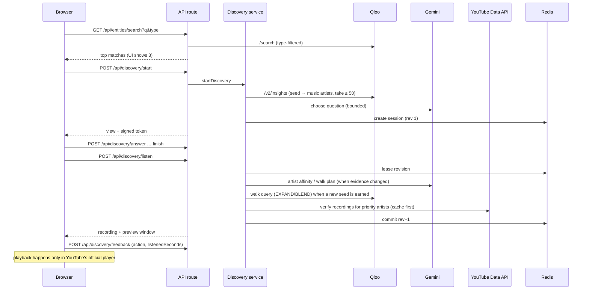
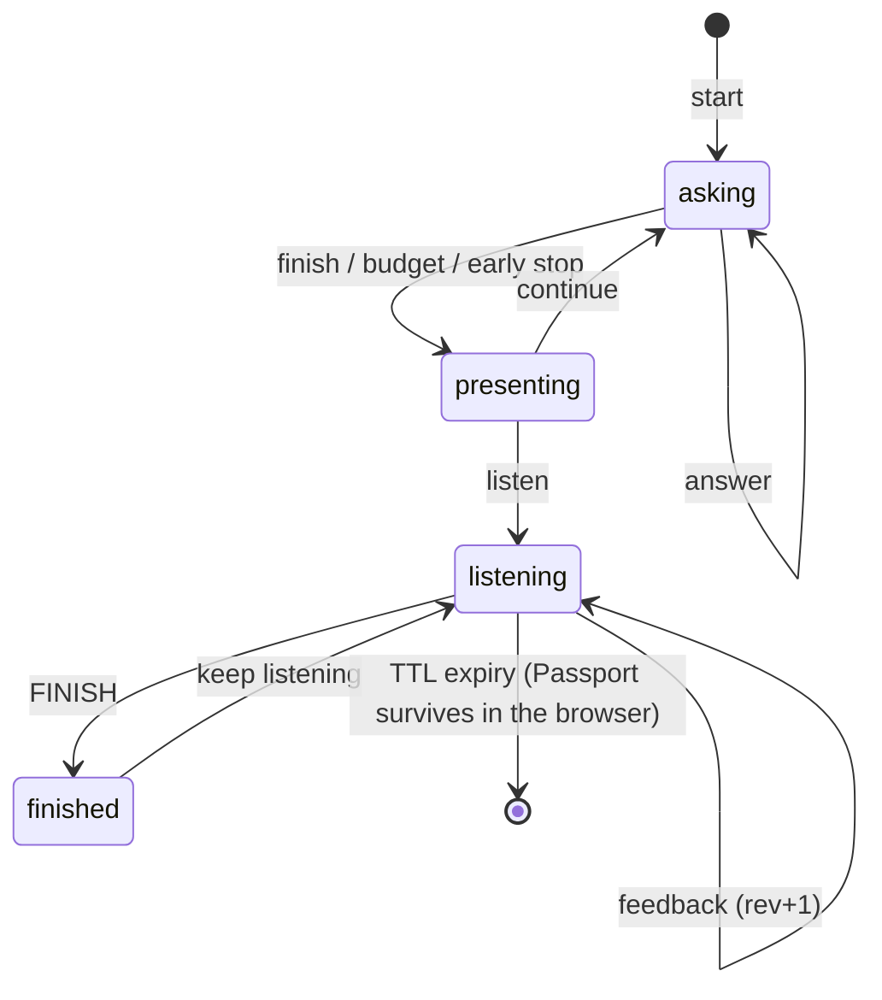

# Architecture

TasteProbe is a single Next.js 16 application: a client front end plus server route handlers. It depends on Qloo, Gemini, YouTube and Upstash Redis.

## Components

| Component | Location | Responsibility |
|---|---|---|
| Client state machine | `src/components/DiscoveryApp.tsx` | Switches between Landing, Workspace (questions), Programme (artists), ListeningStage and PassportView; calls the API through `src/lib/api-client.ts` |
| Listening UI | `src/components/music/ListeningStage.tsx`, `YouTubePlayer.tsx` | Official YouTube IFrame player, Quick preview / Full, reactions, listening-time measurement, the "Through …" path and taste trail |
| Route handlers | `src/app/api/**/route.ts` | 11 JSON endpoints; validation and envelope in `src/lib/validation/http.ts` |
| Discovery service | `src/lib/discovery/service.ts` | Every action as a revisioned session transaction: search, start, answer, finish, reject/accept/continue, listen, feedback |
| Qloo adapter | `src/lib/qloo/live-provider.ts` | `GET /search`, `GET /v2/insights` (header auth, timeouts, ≤2 attempts) |
| Gemini adapter | `src/lib/agent/*` | Bounded discovery agent, question proposer, and selector modes (song, artist affinity, walk planner, preview) |
| YouTube verification | `src/lib/music/{resolver,youtube-data,cache,mappings}.ts` | Reviewed registry plus Data API lookup with identity tiers, filters, corroboration, quota and key failover |
| Taste model | `src/lib/music/{adaptive-listening,taste-walk,supply,listening}.ts` | Signals, ranking, taste walk, supply control |
| State | `src/lib/session/*`, `src/lib/reliability/rate-limit.ts` | Signed tokens, CAS sessions, rate limits (Redis in production) |
| Configuration | `src/lib/config/env.ts` | The only reader of `process.env`; production fail-closed rules |

## Request flow

## State

| Store | Key pattern | TTL | Contents |
|---|---|---|---|
| Redis | `tasteprobe:session:<uuid>` | absolute session TTL (1800 s), 60 s lease | `SessionState`: seed, Qloo candidates, answers, adaptive pool, listening (encounters, feedback, engagement, verified inventory, supply, saved, affinity), taste, walk, usage |
| Redis | `tp:rl:<action>:<hmac(ip)>` | rate-limit window | request counters |
| Redis | `tp:yt:search:{exp,day}:…` | session / 24 h | YouTube quota counters |
| Redis | `tp:yt:artist:v4-context:<qlooId>` | 24 h (resolved), 6 h (none) | verified-recording lookup cache |
| Browser | `localStorage["tasteprobe.passport.v1"]` | none | saved recordings (≤200), re-validated on read |

**Tokens.** The token is `v1.<base64url {v, sid, rev, exp}>.<HMAC-SHA256>`, compared in constant time.

**Handling a request.** Each request:
1. verifies the signature, the expiry, that the record exists, the exact revision and the mode;
2. leases that revision;
3. commits `rev + 1` atomically (Lua compare-and-set in Redis).

As a result, stale, replayed and concurrent requests receive `409`. Expiry is absolute. New state fields are optional, so older sessions still parse.

## API

All routes return `{ ok, data | error, meta }` with `cache-control: no-store`. Session routes take the signed token in the JSON body, never in a URL.

| Route | Purpose | Session | Rate bucket |
|---|---|---|---|
| `GET /api/health` | status, mode, readiness, capabilities | — | — |
| `GET /api/entities/search` | Qloo search for a starting point | — | search |
| `POST /api/discovery/start` | create exploration | creates | start |
| `POST /api/discovery/answer` | answer a question | yes | answer |
| `POST /api/discovery/finish` | end the question round | yes | — |
| `POST /api/discovery/{reject,accept}` | react to a programme artist | yes | answer |
| `POST /api/discovery/continue` | another round | yes | start |
| `POST /api/discovery/listen` | start / switch listening | yes | resolve |
| `POST /api/discovery/feedback` | a listening action | yes | feedback |
| `POST /api/music/resolve` | resolve one artist's recording | yes (read-only) | resolve |

## Security

- **Credentials:**
  - Qloo, Gemini and YouTube keys are server-only and sent in headers.
  - There are no `NEXT_PUBLIC_` variables.
  - `server-only` guards the configuration and provider modules.
- **Validation:** inputs use strict zod schemas. Artist and video IDs are always checked against server state; feedback must target the currently presented recording.
- **Rate limits:** per-IP limits with a hashed IP, on by default in production. Every provider budget is charged before the call.
- **Production fail-closed:** production refuses memory sessions, a TLS bypass and internal verification flags.
- **Logs:** redacted (keys, tokens, secrets).
- **Headers:** CSP allowing only the YouTube player frame and scripts, `frame-ancestors 'none'`, `nosniff`, Referrer-Policy and Permissions-Policy (`next.config.ts`).
- **Secret audit:** `npm run audit:release-secrets` checks configured secret values against all Git objects and client bundles.
